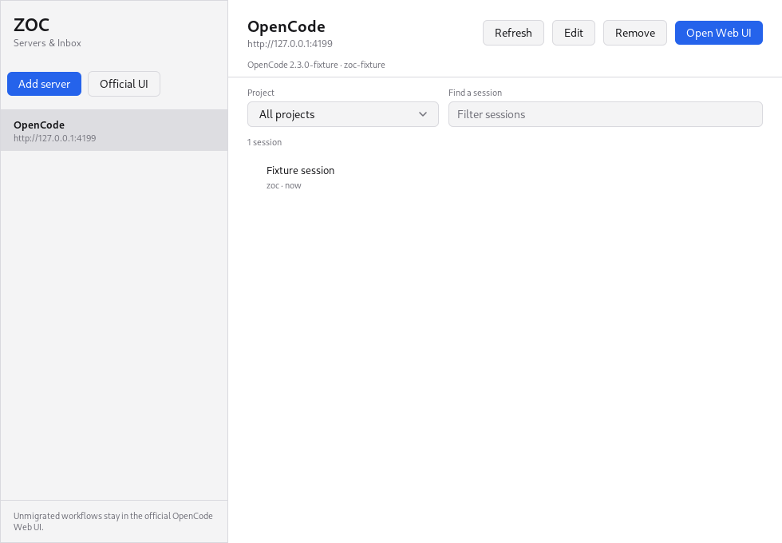

# ZOC

ZOC is a Linux desktop client for an existing [OpenCode](https://github.com/anomalyco/opencode) Server, built with [MyGo](https://github.com/egoist/mygo). It embeds the **official OpenCode Web UI**, adds native desktop capabilities through Go/MyGo, and replaces a small number of complete workflows with MyGo Native UI while keeping the Web UI as the fallback.

ZOC is **client-only**. It never bundles, installs, starts, supervises or updates an OpenCode CLI, Server or Sidecar. You run OpenCode yourself; ZOC connects to it.

## Status

| Area | State | Notes |
|---|---|---|
| Rust/GPUI prototype | replaced | The Rust sources and Cargo manifests are gone from this branch. |
| Official Web UI host | implemented | Built from a pinned `anomalyco/opencode` `dev` SHA; PWA service worker disabled. |
| Fetch/SSE transport | implemented | MyGo's Go-backed fetch, restricted to configured server origins. |
| PTY/WebSocket transport | implemented | MyGo WebSocket through the upstream `openSocket` hook; no `Origin` header; open + `attached` frame verified in WebKit smoke. Terminal UI needs real-server verification. |
| Desktop capabilities | implemented | Frameless-style Linux title bar with in-page minimize/maximize/close, native menu actions, native context menus, dialogs, clipboard, notifications, menus, shortcuts, deep links, window state, opt-in IME caret positioning, app-owned storage. |
| Native UI workflow | implemented | **Servers & Inbox**: server profiles, projects, paginated sessions, connection test, open in Web UI. |
| Upstream sync/release | implemented | Daily/manual workflow pins the SHA, gates, builds, signs in a credential-isolated job, and publishes only on success. Signing keys are not provisioned. |
| Fedora/GNOME/Wayland acceptance | **user verification required** | CI proves WebKitGTK/Xvfb behavior, not a real Fedora desktop or real OpenCode Server. |



The screenshot is the MyGo Native UI **Servers & Inbox** rendered under WebKitGTK/Xvfb during the smoke test.

See [Feature parity](docs/FEATURE_PARITY.md) and [Manual acceptance](docs/ACCEPTANCE.md).

## Verification snapshot

- Latest published artifact: [`zoc-v0.1.1`](https://github.com/zce/zoc/releases/tag/zoc-v0.1.1) (published 2026-11-16, before the release-credential refinement). No new release was published from this refinement; signed updater keys remain unprovisioned.
- CI `44000865794` on `5cbb280`: passed format/vet/tests, adapter typecheck, frontend gates, Linux packaging, WebKitGTK + Native UI smoke, and artifact upload.
- Upstream sync publish `43917676504`: built and published `zoc-v0.1.1` from `anomalyco/opencode` `dev` at `e4606463e7d18fd126ecfac3ec04602f1e44814b` (before the credential-isolation refinement).
- Credential-isolation dry run `44000865900` on `5cbb280`: force-built and verified an unsigned artifact with `publish=false`; the sign and publish jobs were skipped as designed. No new release was created.
- Upstream unchanged run `43918630325`: detected the same SHA and exited successfully without building or releasing.
- Release assets for 0.1.1 were downloaded and verified with `sha256sum -c SHA256SUMS`; the released archive was installed with `install.sh` and passed the WebKitGTK + Native UI smoke. The current PR build also passes `check.sh`, unsigned `build.sh`, signed test-key `build-signed.sh`, and the WebKitGTK + Native UI smoke.
- The fixture smoke asserts the official UI mounts in WebKitGTK, `/api/info` and `/api/event` are reached, the Go-backed WebSocket opens and receives an `attached` frame, storage/clipboard bridge round trips, the in-page window controls are present, the IME cursor binding is callable, and the Native UI inbox renders a 980×680 window.
- Partial real-desktop acceptance on Fedora 45 Workstation, GNOME 51.1, Wayland, against a real OpenCode Server 2.3.0: authentication, real project/session browsing, session opening, Native UI inbox rendering and a real persistent PTY creation passed. Terminal keystrokes, CJK composition, permissions/questions, attachments and native dialogs/notifications remain manual; see [Manual acceptance](docs/ACCEPTANCE.md).

## Runtime requirements

- Fedora Linux x86_64 (primary), GNOME, Wayland.
- GTK 3 and WebKitGTK 4.1/6.0 runtime packages, for example:

  ```sh
  sudo dnf install gtk3 webkit2gtk4.1
  ```

ZOC does not ship Chromium, Electron, Node.js or Bun at runtime. The installed app is a single Go binary plus its desktop resources.

On Wayland, ZOC enables WebKitGTK's DMA-BUF renderer automatically on Intel/AMD Mesa and on NVIDIA 600-series drivers (verified with 620.70 and WebKitGTK 2.54). Older NVIDIA drivers, virtual machines and containers keep the CPU renderer. `ZOC_DMABUF=on|off|auto` overrides the policy; `WEBKIT_DISABLE_DMABUF_RENDERER=0` forces it on at the WebKit level for diagnosis, but can leave a blank window on unsupported drivers. The startup log reports which renderer is active.

## Install the Linux artifact

CI produces `build/linux-amd64/` containing:

- `zoc` — the executable;
- `zoc-<version>-linux-amd64.tar.gz` and `install.sh` — user-managed install;
- `zoc-<version>-1.x86_64.rpm` — Fedora package;
- `upstream.json` and `SHA256SUMS` — provenance and checksums.

```sh
# User-managed archive: keep install.sh beside the archive
tar -xzf zoc-0.1.1-linux-amd64.tar.gz
sh install.sh zoc-0.1.1-linux-amd64.tar.gz

# Or RPM
sudo dnf install ./zoc-0.1.1-1.x86_64.rpm
```

RPM installs update through DNF. Only archive installs can use MyGo's signed in-app updater, and only when the updater key pair is provisioned. See [Upstream sync](docs/UPSTREAM_SYNC.md).

## Use

1. Start your OpenCode Server, e.g. `opencode serve` (outside ZOC; ZOC does not do this).
2. Launch ZOC. A local profile for `http://127.0.0.1:4096` is created on first launch.
3. To add a remote or custom-port server, open **File → Servers & Inbox…** (`Ctrl+Shift+I`), choose **Add server**, enter the name and URL, optionally the password (memory only), and save.
4. The official Web UI opens with the configured servers. All unmigrated workflows remain there.
5. For projects and sessions, the native **Servers & Inbox** lists them and opens a chosen session in the Web UI.

Remote servers must be added in ZOC first. The native transport refuses unconfigured origins, so an arbitrary URL typed into the official connect screen cannot turn ZOC into an open proxy.

## Build and test (Podman only)

No host toolchain or package is needed. Podman is the only local prerequisite.

```sh
# Format, vet, unit tests, adapter typecheck and frontend gates
./scripts/container.sh ./scripts/check.sh

# Build the Web UI, Go app, RPM and archive
./scripts/container.sh ./scripts/build.sh

# WebKitGTK smoke test under Xvfb + a deterministic server fixture
./scripts/container.sh ./scripts/smoke.sh
```

The pinned image is defined by [Containerfile](Containerfile): Fedora 45 by digest, Go 1.27.4 and Bun 1.4.4 by checksum, MyGo 0.9.2, and the upstream OpenCode SHA in [upstream/upstream.json](upstream/upstream.json). See [Build](docs/BUILD.md).

## Known limitations

- Real OpenCode Server workflows, real PTY terminal interaction, CJK composition, native dialogs/notifications and Fedora GNOME/Wayland rendering still require the manual checklist. CI proves WebKitGTK/Xvfb and a fixture, not the desktop.
- The upstream `platform.draftStore` blob hook is not implemented; text drafts and settings persist in ZOC storage, but draft image bytes are not guaranteed across a restart.
- Signed in-app updates are wired only when the updater key pair is provisioned. The signing job is credential-isolated; no build step receives the key. No signed release has been published yet.
- The official Web UI keeps its own server registry. A ZOC profile and that registry can show the same server; removing a ZOC profile does not remove the Web UI's copy.
- **New Window** in the Web UI's app menu is a no-op; ZOC owns one main window, and a second window would need its own window-scoped storage and event routing.
- WebKitGTK's spellcheck suggestions stay in the native context menu, but the Spellcheck on/off and language picker that the Electron app appends are not wired.
- On the tested Fedora/GNOME/Wayland + IBus/Rime host, WebKitGTK's native candidate placement is stable but has a fixed offset. `ZOC_IME_CALC=1` enables the caret-rectangle workaround; it is not the default because it can fight WebKit's own updates and jitter. A fully correct fix needs upstream WebKitGTK/GTK work.
- Server plugins, WSL/SSH plugin servers and all Electron-only GUI plugin host features are out of scope.

## Repository layout

```
main.go                    MyGo host lifecycle, window, menu, deep links
internal/desktop/          Bound desktop API and app-owned storage
internal/native/           MyGo Native UI: Servers & Inbox
internal/opencode/         Narrow typed server API used by Native UI
internal/profiles/         Client server profiles (URLs only, no secrets)
internal/networkpolicy/    Origin allowlist and redirect policy
adapter/src/platform.ts    ZOC Platform implementation for the official Web UI
upstream/patches/          Minimal upstream patch set
upstream/upstream.json     Pinned upstream SHA, toolchain and patch hashes
scripts/                   Container-only build, test, smoke and release helpers
docs/                      Architecture, parity, sync, performance, acceptance
```

## Documentation

- [Architecture](docs/ARCHITECTURE.md)
- [Build](docs/BUILD.md)
- [Upstream sync and releases](docs/UPSTREAM_SYNC.md)
- [Feature parity](docs/FEATURE_PARITY.md)
- [Security model](docs/SECURITY.md)
- [Performance](docs/PERFORMANCE.md)
- [Manual acceptance checklist](docs/ACCEPTANCE.md)
- [Issue #10](https://github.com/zce/zoc/issues/10)
