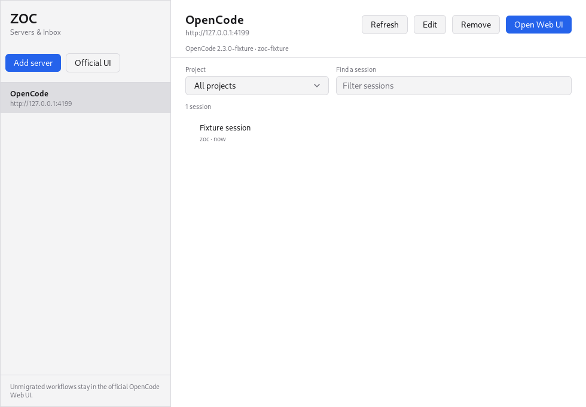

# Architecture

ZOC is a MyGo desktop host around the official OpenCode Web UI. OpenCode Server owns all agent, session, permission and data semantics; ZOC owns the client host, transport policy, desktop integration and a small Native UI surface.

```
anomalyco/opencode @ pinned dev SHA
  packages/app + workspace dependencies
             │
             │ ZOC patch set + vite.zoc.config.ts
             ▼
  static official Web UI (no PWA service worker)
             │
             ▼
  MyGo Go host
  ├─ embedded frontend served at mygo://localhost
  ├─ fetch plugin  → Go HTTP  → configured server origins
  ├─ websocket plugin → Go WS → configured server origins
  ├─ desktop API (dialogs, clipboard, shell, notifications, storage, …)
  └─ Native UI: Servers & Inbox
             │
             ▼
  Linux app: Go binary + GTK 3/WebKitGTK 4.1 runtime
```

## Ownership boundaries

| Component | Owner | Contract |
|---|---|---|
| Agent runtime, session/message semantics, permissions/questions, tools, server data | OpenCode Server | HTTP/SSE/WebSocket API |
| Initial UI, SolidJS state, routes, composer, terminal UI, Markdown/preview rendering | Official OpenCode Web UI | Upstream code at the pinned SHA |
| WebView hosting, Go/TS bindings, desktop APIs, Native UI, packaging, updater | MyGo | MyGo 0.9.2 |
| Server profile policy, transport adapters, desktop bridge, Native inbox, sync/release automation | ZOC | This repository |

ZOC does **not**:

- bundle, install, start, stop, supervise or update OpenCode;
- implement a local agent runtime or write OpenCode's database;
- fork or copy the OpenCode frontend;
- run Electron, Chromium, Node.js or Bun in the installed app;
- duplicate the server's session reducer or maintain a second event stream for Native UI.

## Upstream adapter

The patch set is intentionally tiny. At the pinned SHA it changes two files:

1. `packages/app/src/entry.tsx`
   - creates the ZOC platform instead of the stock web platform;
   - removes PWA service-worker registration;
   - seeds the official server registry with ZOC's configured profiles.
2. `packages/gui-plugins/src/terminal/terminal.tsx`
   - passes ZOC's `openZocSocket` through the existing `createPersistentPtyClient({ openSocket })` hook.

ZOC-owned files added to the upstream build:

- `packages/app/src/zoc/platform.ts` — the `Platform` implementation and transport selection;
- `packages/app/vite.zoc.config.ts` — reuses upstream Solid/Tailwind/theme/icon plugins, omits `vite-plugin-pwa`, and sets the upstream asset layout.

The build regenerates `adapter/src/mygo.ts` from the bound Go service and copies the adapter files into the upstream checkout. Patches and adapter sources are hashed into every release's `upstream.json`.

## Transport policy

`internal/networkpolicy` is the single authority for Go-side HTTP and WebSocket access.

- Allowed origins are exactly the base URLs in the persisted server profiles.
- Loopback aliases (`localhost`, `127.0.0.1`, `::1`) on a configured loopback port are normalized as the same origin.
- `ws:`/`wss:` map to `http:`/`https:` for policy checks.
- Userinfo (`user:pass@host`) is rejected in URLs.
- Redirects are capped at five, must remain on a configured origin, and must not change origin, so credentials cannot be replayed.
- Fetch and WebSocket plugins use the same policy; WebSocket handshakes do not add the `mygo://localhost` Origin header.
- The frontend wrapper sends server requests through MyGo's fetch/WebSocket and leaves app-local (`blob:`, `data:`, `mygo:`) and unrelated external requests on the WebView transport.

OpenCode's origin check accepts a missing `Origin` header for non-browser clients. ZOC relies on that; it does not forge a browser Origin.

## Desktop bridge

`internal/desktop` is bound with `mygo.Bind`. The generated TypeScript client is the only bridge used by the adapter. It implements:

- native file/directory pickers and save dialogs;
- clipboard text and PNG image read/write;
- external URL and local path opening, reveal in file manager;
- system notifications with click correlation back to the page;
- menus and accelerators in the Go host;
- deep links (`zoc://add`, `zoc://open`);
- window state through MyGo's `StateKey`, fullscreen and zoom;
- app-owned settings/drafts storage under `PathUserData`, not OpenCode's data.

Unsupported optional Electron capabilities (GUI plugin host, voice call state, pinch-zoom runtime toggling, diagnostic export) are omitted rather than returning fake success. The Web UI's optional feature checks then hide or skip them.

## Native UI

`internal/native` implements **Servers & Inbox** as a complete native workflow:

- lists configured server profiles;
- adds/edits/removes them (URLs only, passwords stay in memory);
- tests the connection through the same transport policy;
- lists projects and root sessions from the OpenCode API;
- filters sessions, opens a session in the official Web UI, and exposes an **Official UI** fallback button everywhere.



Native UI state is a presentation projection: every snapshot is fetched on demand from OpenCode, with no duplicate reducer and no second SSE connection. Session transcript, composer, permissions, questions and terminal remain in the Web UI.

## Persistence

| Data | Location | Notes |
|---|---|---|
| Server profiles | `PathUserData/servers.json` | Name + URL only, mode 0600 |
| Web UI settings, registry, text drafts | `PathUserData/storage/*.json` | Reached through `Platform.storage`; draft image blobs are not yet persisted by a ZOC draft store |
| Window bounds/state | MyGo `window-state.json` | `StateKey: main`, `StateKey: inbox` |
| Credentials | Web UI memory / native window memory | Never written by ZOC |

The official Web UI's own server registry is still present in its storage, seeded from ZOC profiles. Removing a ZOC profile does not delete the official registry entry; users can remove it in the Web UI's server manager. This is a known duplication at the presentation layer, not a second source of server truth.
